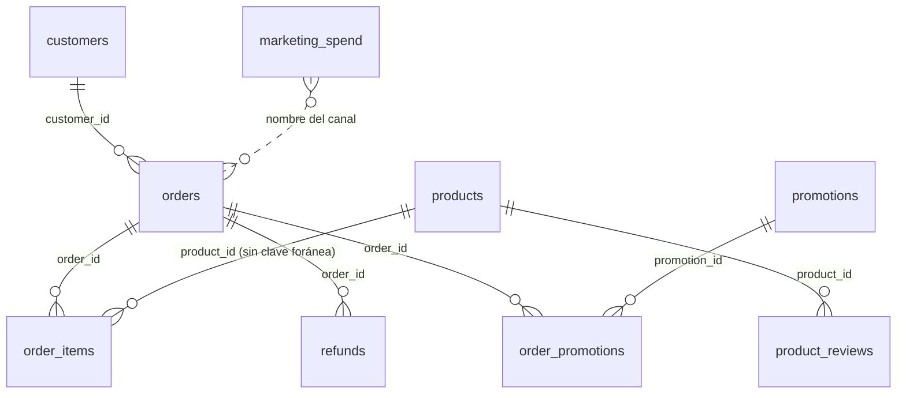

# Scuffers · Presupuesto de marketing del segundo semestre

Análisis del **primer semestre de 2026** (1 de enero a 30 de junio) de una tienda online de moda (escenario ficticio), preparado para la reunión en la que dirección reparte el presupuesto de marketing de H2.

- 📊 **Panel:** `<pendiente: URL de Vercel>`. En local: `cd app && npm run dev`.
- 🖥️ **Decks:**
  - Para dirección, en 12 diapositivas: `presentacion/Scuffers_Presupuesto_H2.pptx`.
  - Este documento en diapositivas, con una por conclusión: `presentacion/Scuffers_Conclusiones_H1.pptx`.
  - Los dos siguen el mismo orden que este documento.
- 🧾 **Queries:** `sql/conclusiones/`. Hay una por conclusión y se ejecutan tal cual ([índice de queries](#anexo-c)).

**Cifras de cabecera (H1)**

| Venta neta | Venta (sin restar devoluciones) | Pedidos | Ticket medio | Compradores | Devolución |
|:---:|:---:|:---:|:---:|:---:|:---:|
| **38.531 €** | 42.041 € | 614 | 68,47 € | 131 | 9,9 % de los pedidos |

<a id="indice"></a>
## Índice

| | Sección | Qué encontrarás |
|---|---|---|
| 1 | [**Resumen ejecutivo**](#resumen) | La historia en cinco pasos, las 9 conclusiones de un vistazo y la respuesta a las cuatro preguntas de dirección |
| 2 | [Antes de leer](#antes) | Qué es la venta neta, el glosario y cómo se lee cada conclusión |
| 3 | [**Conclusiones**](#conclusiones) | [A · Ventas](#bloque-a) (C1–C2) · [B · Clientes](#bloque-b) (C3–C4) · [C · Canales](#bloque-c) (C5–C6) · [D · Producto](#bloque-d) (C7–C9) |
| 4 | [**Plan para H2**](#plan) | 10 acciones, cada una con su cifra y cómo saber si funciona |
| 5 | [Modelado de datos](#modelado) | Tablas, claves, qué filas entran y transformaciones |
| 6 | [Decisiones de presentación](#presentacion) | Para quién es cada vista del panel y qué se descartó |
| 7 | [Supuestos y limitaciones](#supuestos) | Cada decisión con el efecto de la contraria, y las decisiones que cambiamos |
| 8 | [Anexos](#anexos) | Vistas del esquema, notas de dirección, índice de queries y cómo reproducirlo |

---

<a id="resumen"></a>
## 1. Resumen ejecutivo

> [!IMPORTANT]
> **En una frase:** la venta (38.531 € netos) no crece y vive de clientes que repiten cada vez menos. H2 depende de captar, y captar cuesta 32–59 € por cliente en TikTok, Email y Google, frente a 167–725 € en Meta e Instagram.

### La historia en cinco pasos

Cada paso lleva al siguiente, y así está ordenado el documento:

1. **Vendimos 38.531 € netos**, unos 6.400 € al mes ([C1](#c1)).
2. **La venta no crece y vive de quien ya compraba:** en junio el 85 % viene de clientes previos y solo llegan 10 clientes nuevos ([C2](#c2)).
3. **Esa base es pequeña, muy alemana y cada vez menos fiel:** 28 alemanes hacen el 49,3 % de la venta y la recompra a 30 días cae del 82,8 % al 42,1 % ([C3](#c3), [C4](#c4)).
4. **Por eso H2 depende de captar, y el coste cambia mucho según el canal:** de 32 € a 725 € por cliente nuevo. TikTok vendió más gastando 20 veces menos ([C5](#c5), [C6](#c6)).
5. **En producto:** Deporte, en su periodo, vende menos por referencia que el resto. La nota no anticipa las devoluciones. El ingreso por código está mal medido ([C7](#c7), [C8](#c8), [C9](#c9)).

### Las 9 conclusiones de un vistazo

Confianza: 🟢 alta · 🟡 media · 🔴 baja ([qué significa](#confianza)).

| | Conclusión | Cifra clave | Qué hacer | Confianza |
|---|---|---|---|:---:|
| [**C1**](#c1) | El semestre deja 38.531 € de venta neta | 6.400 €/mes · −24 % frente al bruto | Presupuestar sobre la venta neta | 🟢 |
| [**C2**](#c2) | La venta no crece y depende de quien ya compraba | 85 % de clientes previos · 10 nuevos en junio | Recuperar Orgánico · ≥ 20 nuevos al mes | 🟡 |
| [**C3**](#c3) | Alemania hace la mitad de la venta con el 21 % de los compradores | 678 € frente a 190 € por cliente | Test de captación en Alemania · cuidar a los 20 mayores | 🟢 |
| [**C4**](#c4) | Cada cohorte repite menos | 82,8 % → 42,1 % a 30 días | Mensaje de segundo pedido | 🟡 |
| [**C5**](#c5) | Email, Google y TikTok captan mucho más barato que Meta e Instagram | 32–59 € frente a 167–725 € | Mover presupuesto a Email y Google | 🔴 🟡 |
| [**C6**](#c6) | TikTok vendió más gastando 20 veces menos | 263 € → 32 € por cliente nuevo | Subir solo por tramos | 🟡 |
| [**C7**](#c7) | Deporte, en su periodo, vende menos por referencia | 7,1 % de la venta · 472 € frente a 594–709 € | Apuesta acotada | 🔴 |
| [**C8**](#c8) | La nota no anticipa la devolución | Cargo: 5,0★ y 14,3 % · Oversize: 3,21★ y 1,2 % | Guía de tallas · medir por la devolución | 🟡 |
| [**C9**](#c9) | El ingreso por código está inflado | +9,8 % · ningún código rebaja el precio | Registrar el descuento · códigos por canal | 🟢 |

### Respuesta a las cuatro preguntas de dirección

| Pregunta | Respuesta corta | Dónde |
|---|---|---|
| **1. ¿Cuánto hemos vendido y cómo ha evolucionado?** | 38.531 € netos, sin tendencia (entre 4.738 y 8.436 € al mes) y cada vez más dependientes de clientes que ya compraban | [C1](#c1) · [C2](#c2) · [C3](#c3) · [C4](#c4) |
| **2. ¿Qué canales merecen más inversión y cuáles menos?** | **Más:** Email y Google (41 y 59 € por cliente nuevo) y TikTok por tramos (32 €). **Menos:** Meta (167 €) e Instagram (725 €) | [C5](#c5) · [C6](#c6) |
| **3. ¿Qué categorías y productos funcionan?** | En mayo–junio, Ropa hace el 42,7 % de la venta y Deporte el 7,1 % con solo 2 referencias, pero cada una vende menos (472 € frente a 594–709 €). Pantalón Cargo y Zapatillas Classic devuelven más del 13 % | [C7](#c7) · [C8](#c8) · [C9](#c9) |
| **4. ¿Qué haríamos distinto en H2, y con qué cifra?** | Mover dinero de Meta e Instagram a Email y Google, recuperar la captación orgánica, trabajar el segundo pedido y medir bien los códigos | [Plan para H2](#plan) |

<sub>[↑ Volver al índice](#indice)</sub>

---

<a id="antes"></a>
## 2. Antes de leer

> [!NOTE]
> **Venta neta** = subtotal de producto (sin IVA ni envío) de los pedidos válidos y no cancelados de H1, menos lo devuelto. **Solo cuentan las fichas activas del catálogo.** Es la cifra con la que se presupuesta, y todas las conclusiones la usan salvo que digan otra cosa. Las reglas completas están en [Modelado de datos](#modelado).

<details>
<summary>📖 <b>Glosario</b> · 11 términos</summary>

| Término | Qué significa aquí |
|---|---|
| **H1** | 1 de enero a 30 de junio de 2026. Julio (hasta el día 12) se muestra aparte |
| **Venta** | Subtotal de producto de los pedidos entregados, pendientes y devueltos. Los cancelados no son venta |
| **Venta neta** | Venta menos devoluciones, totales y parciales |
| **Cliente nuevo** | Cliente en su primer pedido válido no cancelado. Se asigna al mes y al canal de ese pedido |
| **Cliente previo** | Cliente cuyo primer pedido es de un mes anterior |
| **Coste por cliente nuevo** | Gasto del canal ÷ clientes nuevos que llegaron por ese canal en el mismo tramo |
| **IEC** | Índice de Eficiencia de Canal de la nota de dirección: venta neta atribuida al canal ÷ gasto del canal |
| **Recompra a 30 días** | % de clientes de una cohorte que hacen un segundo pedido en los 30 días siguientes al primero |
| **Cohorte** | Clientes agrupados por el mes de su primer pedido |
| **Tasa de devolución** | Pedidos con alguna devolución ÷ pedidos entregados o devueltos |
| **Catálogo vivo** | Fichas de producto con `active = true` (nota de dirección 4) |

</details>

<a id="confianza"></a>
<details>
<summary>🧭 <b>Cómo se lee cada conclusión</b> · estructura y niveles de confianza</summary>

| Parte | Qué contiene | ¿Visible? |
|---|---|---|
| **Título** | La conclusión, con su cifra y su punto de comparación | Sí |
| **Ficha** (🎯 📊 🧾) | Pregunta de dirección a la que responde, confianza, dónde se ve en el panel y query principal | Sí |
| **Qué dice el dato** | El hecho, con su tabla | Sí |
| **Por qué importa** | Qué debería hacer el negocio, con cifra | Sí |
| 📐 **Cómo lo he calculado** | El criterio exacto: qué incluye y qué excluye | Desplegable |
| 🧾 **Query SQL** | La query exacta, que se copia y se ejecuta tal cual | Desplegable |
| ➕ **Más detalle** | Sensibilidades y notas de dirección, cuando las hay | Desplegable |

**Niveles de confianza:**
- 🟢 **Alta:** cifra contable, o diferencia grande con muestra suficiente.
- 🟡 **Media:** tendencia clara con grupos de 10 a 30 clientes.
- 🔴 **Baja:** pocos casos. Indica la dirección, no la magnitud.

</details>

<sub>[↑ Volver al índice](#indice)</sub>

---

<a id="conclusiones"></a>
## 3. Conclusiones

<a id="bloque-a"></a>
### Bloque A · Cuánto hemos vendido y cómo ha evolucionado

> [!NOTE]
> **Pregunta 1 de dirección.** Primero fijamos la cifra con la que se presupuesta y después vemos cómo se ha movido mes a mes.
>
> **Respuesta corta:** 38.531 € netos, sin tendencia, y cada mes con más peso de los clientes que ya compraban.

<a id="c1"></a>
#### C1 · El semestre deja 38.531 € de venta neta, unos 6.400 € al mes: un 24 % menos que los 50.827 € de subtotal bruto

> 🎯 **Responde a:** Pregunta 1 &nbsp;·&nbsp; **Confianza:** 🟢 Alta (cifra contable)<br>
> 📊 **Panel:** Resumen › Indicadores clave &nbsp;·&nbsp; 🧾 **Query:** [`c1_venta_neta_h1.sql`](sql/conclusiones/c1_venta_neta_h1.sql)

**Qué dice el dato:** En H1 hay 614 pedidos con venta, un ticket medio de 68,47 €, 1.184 unidades y 131 compradores. Del subtotal bruto a la venta neta se pierde un 24 %, sobre todo por cancelados y devoluciones:

| Paso | Pedidos | Importe |
|---|---:|---:|
| Subtotal bruto de H1, todos los pedidos | 719 | 50.827 € |
| − Pedidos excluidos (borrados o con una línea a menos del 50 % de tarifa) | −19 | −702 € |
| − Líneas de fichas inactivas (18 pedidos se quedan sin ninguna línea) | −18 | −3.358 € |
| − Cancelados | −68 | −4.727 € |
| **= Venta H1** | **614** | **42.041 €** |
| − Devoluciones (58 pedidos: 45 enteros y 13 parciales) | | −3.510 € |
| **= Venta neta H1** | **614** | **38.531 €** |

Si los códigos hubieran aplicado el descuento que prometen, la venta neta sería de **37.217 €** (−1.314 €, −3,4 %).

**Por qué importa:**
- **Base para presupuestar H2:** unos 6.400 € netos al mes, no los 50.000 € del subtotal bruto.
- **Qué cifra usar:** según la nota de dirección, finanzas usa la que no contempla descuentos (38.531 €). Si quieren contemplarlos, es 37.217 €.
- **Qué registrar desde ya:** el descuento aplicado en cada pedido (ver [C9](#c9)).

<details>
<summary>📐 <b>Cómo lo he calculado</b></summary>

- **Pedidos:** válidos de H1 y no cancelados. Los pendientes cuentan como venta.
- **Venta:** cantidad × precio cobrado, en las líneas de fichas activas. Sin IVA ni envío.
- **Devoluciones restadas:**
  - Enteras: pedidos en estado `refunded`, por todas sus líneas.
  - Parciales: el reembolso que casa con k unidades de una línea.
- **Otras queries:** el puente está en `c1b_puente_ventas.sql`. El descuento teórico (el mayor `discount_pct` del pedido) está en `c1c_descuento_teorico.sql`.
- **Julio (1 al 12), aparte:** 39 pedidos y 2.587 € netos.

</details>

<details>
<summary>🧾 <b>Query SQL</b> · <code>c1_venta_neta_h1.sql</code></summary>

```sql
with
-- C1 · Cifras de cabecera de H1, con julio (1-12) aparte (README, conclusión 1).
-- Devuelve: una fila por periodo: pedidos, unidades, venta (bruto), devuelto, venta neta, ticket, compradores, cancelados y pendientes.
-- Reglas de limpieza (README, «Modelado de datos»): pedidos borrados o con alguna línea a <50 % de tarifa fuera, líneas con producto inexistente o ficha inactiva fuera,
-- canal normalizado, gasto en EUR con duplicados exactos contados una vez.
ex as (
  select o.id from orders o
  where o.deleted_at is not null
     or exists (select 1 from order_items i join products p on p.id = i.product_id
                where i.order_id = o.id and i.unit_price_cents < 0.5 * p.price_cents)
),
l as (
  select i.id, i.order_id, i.product_id, i.quantity, i.unit_price_cents, p.name, p.category, p.price_cents
  from order_items i join products p on p.id = i.product_id and p.active
  where i.order_id not in (select id from ex)
),
pa as (  -- todos los pedidos válidos (todas las fechas), con su venta de líneas activas
  select o.id, o.customer_id, o.country, o.status, o.created_at,
         case when lower(btrim(o.channel)) = 'meta ads' then 'Meta Ads' else btrim(o.channel) end as canal,
         sum(l.quantity * l.unit_price_cents) / 100.0 as bruto, sum(l.quantity) as uds
  from orders o join l on l.order_id = o.id
  group by 1, 2, 3, 4, 5, 6
),
dv as (  -- devuelto por pedido: entero si refunded, parcial si la línea que casa con el importe es de ficha activa
  select pa.id,
         case when pa.status = 'refunded' then pa.bruto
              else coalesce((select r.amount_cents / 100.0 from refunds r where r.order_id = pa.id
                              and exists (select 1 from l, generate_series(1, l.quantity) k
                                          where l.order_id = pa.id and k * l.unit_price_cents = r.amount_cents)), 0) end as devuelto
  from pa
),
p as (  -- pedidos válidos con venta neta, h1 = ene-jun
  select pa.*, dv.devuelto, pa.bruto - dv.devuelto as neto, pa.created_at < date '2026-07-01' as h1,
         pa.status <> 'cancelled' as venta
  from pa join dv using (id)
),
gasto as (
  select channel as canal, date as fecha,
         case when currency_unit = 'EUR_CENTS' then spend_raw / 100.0 else spend_raw end as eur
  from (select distinct channel, date, spend_raw, currency_unit from marketing_spend) d
),
nuevo as (  -- primer pedido de venta (no cancelado) de cada cliente
  select distinct on (customer_id) customer_id, id, canal, created_at
  from p where venta order by customer_id, created_at, id
),
-- cabecera H1 y julio
x as (select 1)
select case when h1 then 'H1' else 'jul 1-12' end per,
  count(*) filter (where venta) pedidos, round(sum(bruto) filter (where venta)) bruto, round(sum(devuelto) filter (where venta)) devuelto,
  round(sum(neto) filter (where venta)) neto, round(avg(bruto) filter (where venta),2) ticket, sum(uds) filter (where venta) uds,
  count(distinct customer_id) filter (where venta) compradores, count(*) filter (where not venta) cancelados, round(sum(bruto) filter (where not venta)) cancel_eur,
  count(*) filter (where status='pending' and venta) pend, round(sum(bruto) filter (where status='pending')) pend_eur
from p group by 1 order by 1
```

</details>

<a id="c2"></a>
#### C2 · La venta no crece y depende cada vez más de quien ya compraba: en junio el 85 % viene de clientes previos y solo llegan 10 clientes nuevos

> 🎯 **Responde a:** Pregunta 1 &nbsp;·&nbsp; **Confianza:** 🟡 Media (seis meses de serie y solo 10 clientes nuevos en junio)<br>
> 📊 **Panel:** Clientes › Pedidos por mes: nuevos y recurrentes &nbsp;·&nbsp; 🧾 **Query:** [`c2_evolucion_mensual.sql`](sql/conclusiones/c2_evolucion_mensual.sql)

**Qué dice el dato:**
- **Sin tendencia:** la venta neta mensual oscila entre 4.738 y 8.436 €.
- **Más peso de los clientes previos:** pasan del 56 % de la venta en febrero al 85 % en junio.
- **Menos clientes nuevos:** caen de 29 en enero a 10 en junio. La caída de junio es de Orgánico, no de los canales de pago.

| | Ene | Feb | Mar | Abr | May | Jun |
|---|---:|---:|---:|---:|---:|---:|
| Venta neta | 7.067 € | 4.738 € | 5.992 € | 8.436 € | 6.454 € | 5.843 € |
| % de la venta de clientes previos | — | 56 % | 72 % | 72 % | 80 % | **85 %** |
| **Clientes nuevos** | **29** | **25** | **22** | **26** | **19** | **10** |
| … de Orgánico | 9 | 12 | 12 | 6 | 9 | **3** |
| … de canales de pago | 18 | 11 | 9 | 15 | 7 | 7 |
| … de Newsletter y Direct | 2 | 2 | 1 | 5 | 3 | 0 |

**Por qué importa:**
- **H2 no crecerá sin captar.** La venta de los clientes previos aguanta, pero cada cohorte repite menos ([C4](#c4)).
- **La caída de junio viene de Orgánico** (de 12 clientes nuevos en marzo a 3 en junio), no de los canales de pago (7, igual que en mayo). Antes de mover presupuesto hay que revisar el SEO y el alta web de junio.
- **Objetivo para H2:** 20 o más clientes nuevos al mes. La media de febrero a mayo fue de 23.

<details>
<summary>📐 <b>Cómo lo he calculado</b></summary>

- **Cliente nuevo:** cliente en su primer pedido válido no cancelado, en el mes y el canal de ese pedido.
- **% de clientes previos:** venta neta del mes de clientes cuyo primer pedido es de un mes anterior. En enero no se puede calcular porque no hay historia previa.
- **Canales de pago:** Email, Google, Meta, Instagram y TikTok. El origen por canal está en `c2b_nuevos_por_origen.sql`.

</details>

<details>
<summary>🧾 <b>Query SQL</b> · <code>c2_evolucion_mensual.sql</code></summary>

```sql
with
-- C2 · Evolución mensual y peso de los clientes que ya compraban (README, conclusión 2).
-- Devuelve: por mes: pedidos, venta neta, ticket, compradores, clientes nuevos, venta neta de esos nuevos y % de la venta que viene de clientes previos.
-- Reglas de limpieza (README, «Modelado de datos»): pedidos borrados o con alguna línea a <50 % de tarifa fuera, líneas con producto inexistente o ficha inactiva fuera,
-- canal normalizado, gasto en EUR con duplicados exactos contados una vez.
ex as (
  select o.id from orders o
  where o.deleted_at is not null
     or exists (select 1 from order_items i join products p on p.id = i.product_id
                where i.order_id = o.id and i.unit_price_cents < 0.5 * p.price_cents)
),
l as (
  select i.id, i.order_id, i.product_id, i.quantity, i.unit_price_cents, p.name, p.category, p.price_cents
  from order_items i join products p on p.id = i.product_id and p.active
  where i.order_id not in (select id from ex)
),
pa as (  -- todos los pedidos válidos (todas las fechas), con su venta de líneas activas
  select o.id, o.customer_id, o.country, o.status, o.created_at,
         case when lower(btrim(o.channel)) = 'meta ads' then 'Meta Ads' else btrim(o.channel) end as canal,
         sum(l.quantity * l.unit_price_cents) / 100.0 as bruto, sum(l.quantity) as uds
  from orders o join l on l.order_id = o.id
  group by 1, 2, 3, 4, 5, 6
),
dv as (  -- devuelto por pedido: entero si refunded, parcial si la línea que casa con el importe es de ficha activa
  select pa.id,
         case when pa.status = 'refunded' then pa.bruto
              else coalesce((select r.amount_cents / 100.0 from refunds r where r.order_id = pa.id
                              and exists (select 1 from l, generate_series(1, l.quantity) k
                                          where l.order_id = pa.id and k * l.unit_price_cents = r.amount_cents)), 0) end as devuelto
  from pa
),
p as (  -- pedidos válidos con venta neta, h1 = ene-jun
  select pa.*, dv.devuelto, pa.bruto - dv.devuelto as neto, pa.created_at < date '2026-07-01' as h1,
         pa.status <> 'cancelled' as venta
  from pa join dv using (id)
),
gasto as (
  select channel as canal, date as fecha,
         case when currency_unit = 'EUR_CENTS' then spend_raw / 100.0 else spend_raw end as eur
  from (select distinct channel, date, spend_raw, currency_unit from marketing_spend) d
),
nuevo as (  -- primer pedido de venta (no cancelado) de cada cliente
  select distinct on (customer_id) customer_id, id, canal, created_at
  from p where venta order by customer_id, created_at, id
),
-- mensual H1 (y julio 1-12), con el % de la venta neta que viene de clientes cuyo primer pedido es de un mes anterior
n as (select to_char(created_at,'YYYY-MM') mes, count(*) nuevos from nuevo group by 1),
m as (
  select to_char(created_at,'YYYY-MM') mes, count(*) filter (where venta) pedidos, round(sum(neto) filter (where venta)) neto,
   round(avg(bruto) filter (where venta),1) ticket, count(distinct customer_id) filter (where venta) compradores, max(n.nuevos) nuevos,
   round(sum(neto) filter (where venta and customer_id in (select customer_id from nuevo nn where to_char(nn.created_at,'YYYY-MM')=to_char(p.created_at,'YYYY-MM')))) neto_nuevos
  from p left join n on n.mes=to_char(p.created_at,'YYYY-MM') group by 1
)
select m.*, round(100.0*(neto - neto_nuevos)/neto) pct_previos from m order by mes
```

</details>

<sub>[↑ Volver al índice](#indice)</sub>

---

<a id="bloque-b"></a>
### Bloque B · Quién compra y si vuelve

> [!NOTE]
> **Preguntas 1 y 4.** Si la venta se sostiene en quien ya compraba, hay que saber quién es esa base y si sigue volviendo.
>
> **Respuesta corta:** es una base pequeña y concentrada en Alemania, y cada nueva cohorte repite menos que la anterior.

<a id="c3"></a>
#### C3 · 28 compradores alemanes (21,4 %) hacen el 49,3 % de la venta neta: cada uno deja 678 €, frente a 190 € uno español

> 🎯 **Responde a:** Preguntas 1 y 4 &nbsp;·&nbsp; **Confianza:** 🟢 Alta (diferencia estructural: 9,4 frente a 3,4 pedidos por cliente)<br>
> 📊 **Panel:** Clientes › Compradores por país de registro &nbsp;·&nbsp; 🧾 **Query:** [`c3_alemania_pais_registro.sql`](sql/conclusiones/c3_alemania_pais_registro.sql)

**Qué dice el dato:** Alemania y España venden casi lo mismo con un número de compradores muy distinto. Los 20 mayores clientes suman el 53,5 % de la venta neta (los 10 mayores, el 35,2 %), y 17 de esos 20 son alemanes. **Alemania y la dependencia de los mejores clientes son el mismo riesgo.**

| | 🇩🇪 Alemania | 🇪🇸 España |
|---|---:|---:|
| Compradores | 28 (21,4 %) | 103 (78,6 %) |
| Venta neta | 18.979 € (49,3 %) | 19.552 € (50,7 %) |
| Pedidos por cliente | 9,4 | 3,4 |
| **Venta neta por cliente** | **678 €** | **190 €** |
| Entre los 20 mayores clientes | 17 | 3 |
| Con 10 o más pedidos | 13 | 6 |

**Por qué importa:**
- **Un cliente alemán vale unas 3,6 veces uno español,** así que en Alemania se puede aceptar un coste por cliente nuevo mayor. Conviene probarlo con un test de captación allí.
- **Para medirlo hay que etiquetar el país en el gasto de marketing.** Hoy el gasto no tiene país.
- **Alerta de inactividad para los 20 mayores clientes,** que hacen más de la mitad de la venta.

<details>
<summary>📐 <b>Cómo lo he calculado</b></summary>

- **País:** país de registro del cliente (`customers.country`). Venta neta de H1.
- **Concentración:** en `c3b_concentracion_top20.sql`.
- **Con el país de envío de los pedidos:** el reparto apenas cambia (ver [supuestos](#supuestos)).

</details>

<details>
<summary>🧾 <b>Query SQL</b> · <code>c3_alemania_pais_registro.sql</code></summary>

```sql
with
-- C3 · Compradores por país de registro (README, conclusión 3).
-- Devuelve: por país: compradores, venta neta y su peso, pedidos y venta por cliente, cuántos están entre los 20 mayores y cuántos tienen 10 o más pedidos.
-- Reglas de limpieza (README, «Modelado de datos»): pedidos borrados o con alguna línea a <50 % de tarifa fuera, líneas con producto inexistente o ficha inactiva fuera,
-- canal normalizado, gasto en EUR con duplicados exactos contados una vez.
ex as (
  select o.id from orders o
  where o.deleted_at is not null
     or exists (select 1 from order_items i join products p on p.id = i.product_id
                where i.order_id = o.id and i.unit_price_cents < 0.5 * p.price_cents)
),
l as (
  select i.id, i.order_id, i.product_id, i.quantity, i.unit_price_cents, p.name, p.category, p.price_cents
  from order_items i join products p on p.id = i.product_id and p.active
  where i.order_id not in (select id from ex)
),
pa as (  -- todos los pedidos válidos (todas las fechas), con su venta de líneas activas
  select o.id, o.customer_id, o.country, o.status, o.created_at,
         case when lower(btrim(o.channel)) = 'meta ads' then 'Meta Ads' else btrim(o.channel) end as canal,
         sum(l.quantity * l.unit_price_cents) / 100.0 as bruto, sum(l.quantity) as uds
  from orders o join l on l.order_id = o.id
  group by 1, 2, 3, 4, 5, 6
),
dv as (  -- devuelto por pedido: entero si refunded, parcial si la línea que casa con el importe es de ficha activa
  select pa.id,
         case when pa.status = 'refunded' then pa.bruto
              else coalesce((select r.amount_cents / 100.0 from refunds r where r.order_id = pa.id
                              and exists (select 1 from l, generate_series(1, l.quantity) k
                                          where l.order_id = pa.id and k * l.unit_price_cents = r.amount_cents)), 0) end as devuelto
  from pa
),
p as (  -- pedidos válidos con venta neta, h1 = ene-jun
  select pa.*, dv.devuelto, pa.bruto - dv.devuelto as neto, pa.created_at < date '2026-07-01' as h1,
         pa.status <> 'cancelled' as venta
  from pa join dv using (id)
),
gasto as (
  select channel as canal, date as fecha,
         case when currency_unit = 'EUR_CENTS' then spend_raw / 100.0 else spend_raw end as eur
  from (select distinct channel, date, spend_raw, currency_unit from marketing_spend) d
),
nuevo as (  -- primer pedido de venta (no cancelado) de cada cliente
  select distinct on (customer_id) customer_id, id, canal, created_at
  from p where venta order by customer_id, created_at, id
),
-- clientes por país de registro (H1, venta)
c as (select p.customer_id, cu.country, count(*) ped, sum(neto) neto, avg(bruto) ticket from p join customers cu on cu.id=p.customer_id where venta and h1 group by 1,2),
r as (select *, row_number() over (order by neto desc) rn from c)
select country, count(*) compradores, round(100.0*count(*)/sum(count(*)) over (),1) pct_compr, round(sum(neto)) neto, round(100.0*sum(neto)/sum(sum(neto)) over (),1) pct_neto,
 round(avg(ped),1) ped_cliente, round(sum(neto)/count(*)) neto_cliente, count(*) filter (where rn<=20) top20, count(*) filter (where ped>=10) con10
from r group by 1 order by 1
```

</details>

<a id="c4"></a>
#### C4 · Cada cohorte repite menos: vuelve a comprar en 30 días el 82,8 % de los captados en enero y solo el 42,1 % de los de mayo

> 🎯 **Responde a:** Preguntas 1 y 4 &nbsp;·&nbsp; **Confianza:** 🟡 Media (cohortes de 19 a 29 clientes, pero la caída es continua durante cinco meses)<br>
> 📊 **Panel:** Clientes › Valor y frecuencia (recompra global; la recompra por cohorte solo está en la query) &nbsp;·&nbsp; 🧾 **Query:** [`c4_recompra_cohortes.sql`](sql/conclusiones/c4_recompra_cohortes.sql)

**Qué dice el dato:** La recompra a 30 días baja todos los meses, sin excepción. A 90 días, un cliente nuevo de febrero a abril deja 232 € netos, la mitad que uno de enero (464 €).

| Cohorte | Ene | Feb | Mar | Abr | May |
|---|---:|---:|---:|---:|---:|
| Clientes nuevos | 29 | 25 | 22 | 26 | 19 |
| Repiten en 30 días | 24 | 18 | 14 | 13 | 8 |
| **% que repite** | **82,8 %** | **72,0 %** | **63,6 %** | **50,0 %** | **42,1 %** |

**Por qué importa:** Captar no basta si lo captado repite cada vez menos. Para H2:
- **Mensaje de segundo pedido** a los 10 días del primero.
- **KPI mensual:** recompra a 30 días de la última cohorte.
- **Valorar la captación a 232 € por cliente a 90 días,** no con la media del semestre.

<details>
<summary>📐 <b>Cómo lo he calculado</b></summary>

- **Recompra:** un segundo pedido válido no cancelado dentro de los 30 días siguientes al primero.
- **Cohortes incluidas:** solo las que tienen 30 días observables hasta el 12 de julio (primer pedido hasta el 12 de junio). Junio queda fuera: solo 6 de sus clientes los tienen.
- **Valor a 90 días:** cohortes con primer pedido hasta el 13 de abril, en `c4b_valor_90_dias.sql`.

</details>

<details>
<summary>➕ <b>Más detalle</b> · cliente activo según la nota de dirección 3</summary>

Con la definición de **cliente activo** de la nota de dirección 3 (al menos un pedido entregado) hay 129 activos con un 75,2 % de recompra, frente a 131 compradores y un 80,2 %. La query está en `c4c_cliente_activo_nota3.sql`.

</details>

<details>
<summary>🧾 <b>Query SQL</b> · <code>c4_recompra_cohortes.sql</code></summary>

```sql
with
-- C4 · Recompra a 30 días por cohorte (mes del primer pedido) (README, conclusión 4).
-- Devuelve: por cohorte con 30 días observables: clientes, cuántos repiten en 30 días, % y venta neta media a 60 días.
-- Reglas de limpieza (README, «Modelado de datos»): pedidos borrados o con alguna línea a <50 % de tarifa fuera, líneas con producto inexistente o ficha inactiva fuera,
-- canal normalizado, gasto en EUR con duplicados exactos contados una vez.
ex as (
  select o.id from orders o
  where o.deleted_at is not null
     or exists (select 1 from order_items i join products p on p.id = i.product_id
                where i.order_id = o.id and i.unit_price_cents < 0.5 * p.price_cents)
),
l as (
  select i.id, i.order_id, i.product_id, i.quantity, i.unit_price_cents, p.name, p.category, p.price_cents
  from order_items i join products p on p.id = i.product_id and p.active
  where i.order_id not in (select id from ex)
),
pa as (  -- todos los pedidos válidos (todas las fechas), con su venta de líneas activas
  select o.id, o.customer_id, o.country, o.status, o.created_at,
         case when lower(btrim(o.channel)) = 'meta ads' then 'Meta Ads' else btrim(o.channel) end as canal,
         sum(l.quantity * l.unit_price_cents) / 100.0 as bruto, sum(l.quantity) as uds
  from orders o join l on l.order_id = o.id
  group by 1, 2, 3, 4, 5, 6
),
dv as (  -- devuelto por pedido: entero si refunded, parcial si la línea que casa con el importe es de ficha activa
  select pa.id,
         case when pa.status = 'refunded' then pa.bruto
              else coalesce((select r.amount_cents / 100.0 from refunds r where r.order_id = pa.id
                              and exists (select 1 from l, generate_series(1, l.quantity) k
                                          where l.order_id = pa.id and k * l.unit_price_cents = r.amount_cents)), 0) end as devuelto
  from pa
),
p as (  -- pedidos válidos con venta neta, h1 = ene-jun
  select pa.*, dv.devuelto, pa.bruto - dv.devuelto as neto, pa.created_at < date '2026-07-01' as h1,
         pa.status <> 'cancelled' as venta
  from pa join dv using (id)
),
gasto as (
  select channel as canal, date as fecha,
         case when currency_unit = 'EUR_CENTS' then spend_raw / 100.0 else spend_raw end as eur
  from (select distinct channel, date, spend_raw, currency_unit from marketing_spend) d
),
nuevo as (  -- primer pedido de venta (no cancelado) de cada cliente
  select distinct on (customer_id) customer_id, id, canal, created_at
  from p where venta order by customer_id, created_at, id
),
-- recompra a 30 días por cohorte (primer pedido H1), con 30 días observables hasta 12-jul
x as (select 1)
select to_char(n.created_at,'YYYY-MM') cohorte, count(*) clientes,
 count(*) filter (where exists (select 1 from p p2 where p2.customer_id=n.customer_id and p2.venta and p2.id<>n.id and p2.created_at between n.created_at and n.created_at+30)) repiten30,
 round(100.0*count(*) filter (where exists (select 1 from p p2 where p2.customer_id=n.customer_id and p2.venta and p2.id<>n.id and p2.created_at between n.created_at and n.created_at+30))/count(*),1) pct,
 round(avg((select sum(neto) from p p2 where p2.customer_id=n.customer_id and p2.venta and p2.created_at <= n.created_at+60))) neto60
from nuevo n where n.created_at <= date '2026-06-12' group by 1 order by 1
```

</details>

<sub>[↑ Volver al índice](#indice)</sub>

---

<a id="bloque-c"></a>
### Bloque C · Qué canales merecen más inversión

> [!NOTE]
> **Pregunta 2 de dirección.** Con una base que se desgasta, H2 depende de captar. Por el cambio de atribución de marzo, los canales se comparan de marzo a junio, y por **coste por cliente nuevo**, porque el presupuesto que se decide es de captación.
>
> **Respuesta corta:** más a Email y Google, TikTok por tramos y menos a Meta e Instagram.

<a id="c5"></a>
#### C5 · Desde marzo, captar un cliente nuevo cuesta 32–59 € en TikTok, Email y Google, frente a 167 € en Meta y 725 € en Instagram

> 🎯 **Responde a:** Pregunta 2 &nbsp;·&nbsp; **Confianza:** 🔴 Baja en las cifras exactas (TikTok capta 5 clientes, Meta 6 e Instagram 1) · 🟡 media en el orden, que no cambia al unir canales<br>
> 📊 **Panel:** Marketing › Qué canal capta clientes más barato &nbsp;·&nbsp; 🧾 **Query:** [`c5_coste_cliente_nuevo_canal.sql`](sql/conclusiones/c5_coste_cliente_nuevo_canal.sql)

**Qué dice el dato:** Por cada cliente nuevo, Meta cuesta casi 3 veces más que Google, e Instagram 12 veces más. La mayor parte de la venta que se atribuye a cada canal de pago (entre el 75,5 % y el 92,5 %) es recompra de clientes ya captados.

| Canal | Gasto | Clientes nuevos | **Coste por cliente nuevo** | % de su venta que es recompra |
|---|---:|---:|---:|---:|
| TikTok | 160 € | 5 | **32 €** | 92,5 % |
| Email | 449 € | 11 | **41 €** | 83,3 % |
| Google | 883 € | 15 | **59 €** | 75,5 % |
| Meta | 1.004 € | 6 | **167 €** | 89,8 % |
| Instagram | 725 € | 1 | **725 €** | 80,7 % |

Sin gasto, Orgánico capta 30 clientes nuevos en el mismo tramo, Newsletter 8 y Direct 1.

**Por qué importa:** Plan para H2, sin cambiar el presupuesto total:
- **Pausar Instagram como test:** 725 € en cuatro meses, unos 180 € al mes.
- **Bajar Meta.**
- **Llevar ese dinero a Email y Google,** con un tope de 59 € por cliente nuevo.
- **TikTok, solo por tramos** ([C6](#c6)).

> [!TIP]
> **Cuenta de ejemplo.** Si los unos 1.090 € que Instagram gastaría en H2 rindieran como Google (59 € por cliente), serían unos 18 clientes nuevos en vez de 1 o 2. A 232 € netos por cliente a 90 días ([C4](#c4)), son unos 4.200 € de venta. El cálculo supone que Google mantiene su coste medio con más gasto, algo que estos datos no permiten comprobar ([limitaciones](#limitaciones)).

<details>
<summary>📐 <b>Cómo lo he calculado</b></summary>

- **Gasto:** del 1 de marzo al 30 de junio, en euros (Google Ads viene en céntimos) y con las filas duplicadas contadas una vez.
- **Clientes nuevos:** los clientes cuyo primer pedido válido no cancelado llegó por ese canal en ese tramo.
- **% de recompra:** parte de la venta neta atribuida al canal que no es primer pedido.
- **Canales unidos, como en el anexo** (`c5b_canales_unidos.sql`): Meta + Instagram cuestan 247 € por cliente nuevo y Email + Newsletter, 24 €. La decisión no cambia.

</details>

<details>
<summary>➕ <b>Más detalle</b> · IEC y ticket por canal (notas de dirección 1 y 6): se aplican, pero no sirven para decidir</summary>

| Canal | IEC (venta neta ÷ gasto) | Ticket medio | % de pedidos a Alemania |
|---|---:|---:|---:|
| TikTok | 15,5× | 67,6 € | 50 % |
| Email | 7,9× | 62,2 € | 25 % |
| Google | 4,3× | 61,4 € | 33 % |
| Meta | 5,0× | 78,5 € | 83 % |
| Instagram | 0,8× | 73,7 € | 75 % |

- **IEC (nota 1):** mide sobre todo recompra, así que no sirve para repartir un presupuesto de captación.
- **Ticket medio por canal (nota 6):**
  - Pone arriba a Meta e Instagram porque el 83 % y el 75 % de sus pedidos van a Alemania.
  - Mide el país, no la eficiencia del canal, y no tiene en cuenta el gasto.
  - **No creemos que sea una medida válida para comparar canales.**

</details>

<details>
<summary>🧾 <b>Query SQL</b> · <code>c5_coste_cliente_nuevo_canal.sql</code></summary>

```sql
with
-- C5 · Canales de marzo a junio (README, conclusión 5).
-- Devuelve: por canal: gasto, clientes nuevos, coste por cliente nuevo (cac), venta neta, IEC, % de venta de recompra, ticket y % de pedidos a Alemania.
-- Reglas de limpieza (README, «Modelado de datos»): pedidos borrados o con alguna línea a <50 % de tarifa fuera, líneas con producto inexistente o ficha inactiva fuera,
-- canal normalizado, gasto en EUR con duplicados exactos contados una vez.
ex as (
  select o.id from orders o
  where o.deleted_at is not null
     or exists (select 1 from order_items i join products p on p.id = i.product_id
                where i.order_id = o.id and i.unit_price_cents < 0.5 * p.price_cents)
),
l as (
  select i.id, i.order_id, i.product_id, i.quantity, i.unit_price_cents, p.name, p.category, p.price_cents
  from order_items i join products p on p.id = i.product_id and p.active
  where i.order_id not in (select id from ex)
),
pa as (  -- todos los pedidos válidos (todas las fechas), con su venta de líneas activas
  select o.id, o.customer_id, o.country, o.status, o.created_at,
         case when lower(btrim(o.channel)) = 'meta ads' then 'Meta Ads' else btrim(o.channel) end as canal,
         sum(l.quantity * l.unit_price_cents) / 100.0 as bruto, sum(l.quantity) as uds
  from orders o join l on l.order_id = o.id
  group by 1, 2, 3, 4, 5, 6
),
dv as (  -- devuelto por pedido: entero si refunded, parcial si la línea que casa con el importe es de ficha activa
  select pa.id,
         case when pa.status = 'refunded' then pa.bruto
              else coalesce((select r.amount_cents / 100.0 from refunds r where r.order_id = pa.id
                              and exists (select 1 from l, generate_series(1, l.quantity) k
                                          where l.order_id = pa.id and k * l.unit_price_cents = r.amount_cents)), 0) end as devuelto
  from pa
),
p as (  -- pedidos válidos con venta neta, h1 = ene-jun
  select pa.*, dv.devuelto, pa.bruto - dv.devuelto as neto, pa.created_at < date '2026-07-01' as h1,
         pa.status <> 'cancelled' as venta
  from pa join dv using (id)
),
gasto as (
  select channel as canal, date as fecha,
         case when currency_unit = 'EUR_CENTS' then spend_raw / 100.0 else spend_raw end as eur
  from (select distinct channel, date, spend_raw, currency_unit from marketing_spend) d
),
nuevo as (  -- primer pedido de venta (no cancelado) de cada cliente
  select distinct on (customer_id) customer_id, id, canal, created_at
  from p where venta order by customer_id, created_at, id
),
-- canales mar-jun: CAC, IEC (neto/gasto), ROAS bruto, % recompra, ticket
g as (select canal, sum(eur) gasto from gasto where fecha between '2026-03-01' and '2026-06-30' group by 1),
v as (select p.*, (p.id in (select id from nuevo)) primero from p where venta and created_at between '2026-03-01' and '2026-06-30')
select v.canal, count(*) pedidos, count(*) filter (where primero) nuevos, round(g.gasto) gasto, round(g.gasto/nullif(count(*) filter (where primero),0)) cac,
 round(sum(neto)) neto, round(sum(neto)/g.gasto,1) iec, round(100.0*sum(neto) filter (where not primero)/sum(neto),1) pct_recompra,
 round(avg(bruto),1) ticket, round(100.0*count(*) filter (where country='DE')/count(*)) pct_de
from v left join g using (canal) group by v.canal, g.gasto order by cac nulls last
```

</details>

<a id="c6"></a>
#### C6 · TikTok vendió más al mes gastando 20 veces menos: 788 €/mes en enero–febrero frente a 40 €/mes desde marzo

> 🎯 **Responde a:** Preguntas 2 y 4 &nbsp;·&nbsp; **Confianza:** 🟡 Media (antes y después sin grupo de control, pero con un recorte del 95 % y sin caída de venta)<br>
> 📊 **Panel:** Marketing › Evolución &nbsp;·&nbsp; 🧾 **Query:** [`c6_tiktok_antes_despues.sql`](sql/conclusiones/c6_tiktok_antes_despues.sql)

**Qué dice el dato:** Con un 95 % menos de gasto, TikTok hizo más pedidos al mes y su coste por cliente nuevo pasó de 263 € a 32 €. En el mismo cambio, el gasto total en marketing bajó un 47 % y la venta neta total subió un 13 %.

| Media mensual | Ene–feb | Mar–jun |
|---|---:|---:|
| Gasto en TikTok | 788 € | 40 € |
| Pedidos de TikTok | 9,0 | 10,5 |
| Venta neta atribuida a TikTok | 527 € | 621 € |
| Clientes nuevos de TikTok (en todo el tramo) | 6 | 5 |
| **Coste por cliente nuevo de TikTok** | **263 €** | **32 €** |
| Gasto total en marketing | 1.511 € | 805 € |
| Venta neta total | 5.903 € | 6.681 € |

**Por qué importa:** El gasto de enero y febrero no compraba ventas.
- **No volver a ese nivel:** serían unos 4.700 € en H2 sin retorno visible.
- **Si se sube, que sea por tramos:** por ejemplo, 120 € al mes durante 8 semanas. Se mantiene solo si el cliente nuevo cuesta menos de 59 €, lo que cuesta en Google.

<details>
<summary>📐 <b>Cómo lo he calculado</b></summary>

- **Medias mensuales:** los tramos duran 2 y 4 meses, así que se comparan por mes.
- **Venta atribuida:** venta neta de los pedidos con canal TikTok Ads.
- **Coste por cliente nuevo:** gasto del tramo ÷ clientes nuevos que llegaron por TikTok en ese tramo.

</details>

<details>
<summary>🧾 <b>Query SQL</b> · <code>c6_tiktok_antes_despues.sql</code></summary>

```sql
with
-- C6 · TikTok antes y después de marzo, en medias mensuales (README, conclusión 6).
-- Devuelve: por tramo, gasto, pedidos, venta neta y clientes nuevos de TikTok (con su coste por cliente nuevo), y gasto, venta neta y clientes nuevos totales.
-- Reglas de limpieza (README, «Modelado de datos»): pedidos borrados o con alguna línea a <50 % de tarifa fuera, líneas con producto inexistente o ficha inactiva fuera,
-- canal normalizado, gasto en EUR con duplicados exactos contados una vez.
ex as (
  select o.id from orders o
  where o.deleted_at is not null
     or exists (select 1 from order_items i join products p on p.id = i.product_id
                where i.order_id = o.id and i.unit_price_cents < 0.5 * p.price_cents)
),
l as (
  select i.id, i.order_id, i.product_id, i.quantity, i.unit_price_cents, p.name, p.category, p.price_cents
  from order_items i join products p on p.id = i.product_id and p.active
  where i.order_id not in (select id from ex)
),
pa as (  -- todos los pedidos válidos (todas las fechas), con su venta de líneas activas
  select o.id, o.customer_id, o.country, o.status, o.created_at,
         case when lower(btrim(o.channel)) = 'meta ads' then 'Meta Ads' else btrim(o.channel) end as canal,
         sum(l.quantity * l.unit_price_cents) / 100.0 as bruto, sum(l.quantity) as uds
  from orders o join l on l.order_id = o.id
  group by 1, 2, 3, 4, 5, 6
),
dv as (  -- devuelto por pedido: entero si refunded, parcial si la línea que casa con el importe es de ficha activa
  select pa.id,
         case when pa.status = 'refunded' then pa.bruto
              else coalesce((select r.amount_cents / 100.0 from refunds r where r.order_id = pa.id
                              and exists (select 1 from l, generate_series(1, l.quantity) k
                                          where l.order_id = pa.id and k * l.unit_price_cents = r.amount_cents)), 0) end as devuelto
  from pa
),
p as (  -- pedidos válidos con venta neta, h1 = ene-jun
  select pa.*, dv.devuelto, pa.bruto - dv.devuelto as neto, pa.created_at < date '2026-07-01' as h1,
         pa.status <> 'cancelled' as venta
  from pa join dv using (id)
),
gasto as (
  select channel as canal, date as fecha,
         case when currency_unit = 'EUR_CENTS' then spend_raw / 100.0 else spend_raw end as eur
  from (select distinct channel, date, spend_raw, currency_unit from marketing_spend) d
),
nuevo as (  -- primer pedido de venta (no cancelado) de cada cliente
  select distinct on (customer_id) customer_id, id, canal, created_at
  from p where venta order by customer_id, created_at, id
),
-- TikTok y total, enero-febrero frente a marzo-junio, en medias mensuales (los tramos duran 2 y 4 meses)
tr as (select 'ene-feb' tramo, 2.0 meses, date '2026-01-01' ini, date '2026-03-01' fin
       union all select 'mar-jun', 4.0, date '2026-03-01', date '2026-07-01')
select tramo,
 round((select sum(eur) from gasto where canal = 'TikTok Ads' and fecha >= ini and fecha < fin) / meses) gasto_tt_mes,
 round((select count(*) from p where venta and canal = 'TikTok Ads' and created_at >= ini and created_at < fin) / meses, 1) ped_tt_mes,
 round((select sum(neto) from p where venta and canal = 'TikTok Ads' and created_at >= ini and created_at < fin) / meses) neto_tt_mes,
 (select count(*) from nuevo where canal = 'TikTok Ads' and created_at >= ini and created_at < fin) nuevos_tt_tramo,
 round((select sum(eur) from gasto where canal = 'TikTok Ads' and fecha >= ini and fecha < fin)
       / nullif((select count(*) from nuevo where canal = 'TikTok Ads' and created_at >= ini and created_at < fin), 0)) cac_tt,
 round((select sum(eur) from gasto where fecha >= ini and fecha < fin) / meses) gasto_total_mes,
 round((select sum(neto) from p where venta and created_at >= ini and created_at < fin) / meses) neto_total_mes,
 round((select count(*) from nuevo where created_at >= ini and created_at < fin) / meses, 1) nuevos_total_mes
from tr order by tramo
```

</details>

<sub>[↑ Volver al índice](#indice)</sub>

---

<a id="bloque-d"></a>
### Bloque D · Qué productos funcionan y qué no se puede medir

> [!NOTE]
> **Pregunta 3 de dirección.** Qué categorías y productos funcionan. Se incluyen aquí los códigos promocionales, porque cambian cómo se mide la venta.
>
> **Respuesta corta:** Deporte, en su periodo, vende menos por referencia que el resto. La nota no anticipa las devoluciones. El ingreso por código está mal medido.

<a id="c7"></a>
#### C7 · Desde que existe (mayo–junio), Deporte hace el 7,1 % de la venta con 2 referencias, pero cada una vende 472 €, por debajo de los 594–709 € del resto

> 🎯 **Responde a:** Pregunta 3 &nbsp;·&nbsp; **Confianza:** 🔴 Baja (2 referencias activas y dos meses de historia)<br>
> 📊 **Panel:** Producto › Categorías desde que existe Deporte &nbsp;·&nbsp; 🧾 **Query:** [`c7_categorias_deporte.sql`](sql/conclusiones/c7_categorias_deporte.sql)

> [!WARNING]
> **El enunciado lleva a error.** El anexo dice que las cuatro categorías están «en catálogo desde principios de año». Pero las fichas de Deporte se dan de alta el 1 de mayo, y no tiene ninguna venta antes. Si se compara el semestre entero, Deporte parece residual (2,2 % de la venta), cuando solo estuvo a la venta dos de los seis meses. **Omitimos esa indicación y comparamos las categorías solo en mayo y junio.**

**Qué dice el dato:** En mayo y junio, Deporte hace el 7,1 % de la venta con 2 de las 21 referencias activas. Por referencia vende menos que cualquier otra categoría. Por unidades vende más que Calzado, y ninguna de sus unidades se ha devuelto. Su venta es estable: 481 € en mayo y 463 € en junio.

| Categoría (may–jun) | Referencias | Venta | Peso | **Venta por referencia** | Unidades por referencia | Precio medio | Devolución (unidades) |
|---|---:|---:|---:|---:|---:|---:|---:|
| Ropa | 8 | 5.671 € | 42,7 % | **709 €** | 20,1 | 35,23 € | 8,8 % |
| Calzado | 5 | 3.103 € | 23,4 % | **621 €** | 9,4 | 66,02 € | 6,4 % |
| Accesorios | 6 | 3.564 € | 26,8 % | **594 €** | 22,7 | 26,21 € | 7,1 % |
| Deporte | 2 | 944 € | 7,1 % | **472 €** | 16,5 | 28,62 € | 0 % |

**Por qué importa:**
- **Deporte no es una categoría residual.** El 2,2 % del semestre era un efecto de calendario.
- **Aún no justifica ser la gran apuesta de H2:** cada referencia vende menos que en el resto de categorías, y la venta no crece de mayo a junio.
- **Tiene argumentos a favor:** cero devoluciones (0 de 29 unidades entregadas) y más unidades por referencia que Calzado.
- **Propuesta: apuesta acotada.**
  - Ampliar referencias por tramos.
  - Mantener cada referencia solo si alcanza la venta por referencia de Accesorios (594 € cada dos meses).
  - Antes, aclarar el estado de Mochila Deporte y Camiseta Técnica, que están marcadas como inactivas pero se venden.

<details>
<summary>📐 <b>Cómo lo he calculado</b></summary>

- **Periodo:** pedidos no cancelados del 1 de mayo al 30 de junio, el único tramo con las cuatro categorías a la venta.
- **Venta:** líneas de fichas activas, a precio cobrado y sin restar devoluciones.
- **Venta por referencia:** venta ÷ referencias con venta en el tramo.
- **Devolución:** unidades devueltas ÷ unidades de pedidos entregados o devueltos, con el mismo criterio que [C8](#c8).

</details>

<details>
<summary>➕ <b>Más detalle</b> · si se cuentan las fichas inactivas (nota de dirección 4)</summary>

La nota de dirección 4 deja fuera dos referencias de Deporte, Mochila Deporte y Camiseta Técnica, que siguen vendiendo en julio. Contándolas (`c7b_categorias_con_inactivas.sql`), Deporte sube al **15,0 %** de la venta de mayo–junio y a **544 € por referencia**. Sigue siendo la categoría que menos vende por referencia.

</details>

<details>
<summary>🧾 <b>Query SQL</b> · <code>c7_categorias_deporte.sql</code></summary>

```sql
with
-- C7 · Categorías en mayo-junio, el único tramo en que existen las cuatro: Deporte se da de alta el 1 de mayo (README, conclusión 7).
-- Devuelve: por categoría, referencias con venta, unidades, venta, peso, venta y unidades por referencia, precio medio, venta de mayo y de junio y % de unidades devueltas.
-- Reglas de limpieza (README, «Modelado de datos»): pedidos borrados o con alguna línea a <50 % de tarifa fuera, líneas con producto inexistente o ficha inactiva fuera,
-- canal normalizado, gasto en EUR con duplicados exactos contados una vez.
ex as (
  select o.id from orders o
  where o.deleted_at is not null
     or exists (select 1 from order_items i join products p on p.id = i.product_id
                where i.order_id = o.id and i.unit_price_cents < 0.5 * p.price_cents)
),
l as (
  select i.id, i.order_id, i.product_id, i.quantity, i.unit_price_cents, p.name, p.category, p.price_cents
  from order_items i join products p on p.id = i.product_id and p.active
  where i.order_id not in (select id from ex)
),
pa as (  -- todos los pedidos válidos (todas las fechas), con su venta de líneas activas
  select o.id, o.customer_id, o.country, o.status, o.created_at,
         case when lower(btrim(o.channel)) = 'meta ads' then 'Meta Ads' else btrim(o.channel) end as canal,
         sum(l.quantity * l.unit_price_cents) / 100.0 as bruto, sum(l.quantity) as uds
  from orders o join l on l.order_id = o.id
  group by 1, 2, 3, 4, 5, 6
),
dv as (  -- devuelto por pedido: entero si refunded, parcial si la línea que casa con el importe es de ficha activa
  select pa.id,
         case when pa.status = 'refunded' then pa.bruto
              else coalesce((select r.amount_cents / 100.0 from refunds r where r.order_id = pa.id
                              and exists (select 1 from l, generate_series(1, l.quantity) k
                                          where l.order_id = pa.id and k * l.unit_price_cents = r.amount_cents)), 0) end as devuelto
  from pa
),
p as (  -- pedidos válidos con venta neta, h1 = ene-jun
  select pa.*, dv.devuelto, pa.bruto - dv.devuelto as neto, pa.created_at < date '2026-07-01' as h1,
         pa.status <> 'cancelled' as venta
  from pa join dv using (id)
),
gasto as (
  select channel as canal, date as fecha,
         case when currency_unit = 'EUR_CENTS' then spend_raw / 100.0 else spend_raw end as eur
  from (select distinct channel, date, spend_raw, currency_unit from marketing_spend) d
),
nuevo as (  -- primer pedido de venta (no cancelado) de cada cliente
  select distinct on (customer_id) customer_id, id, canal, created_at
  from p where venta order by customer_id, created_at, id
),
-- líneas de fichas activas en pedidos no cancelados de mayo y junio
lv as (
  select l.*, p.created_at f, p.status from l join p on p.id = l.order_id
  where p.venta and p.created_at >= date '2026-05-01' and p.created_at < date '2026-07-01'
),
dvl as (  -- unidades devueltas por línea (entera si refunded, k unidades si el reembolso casa con la línea)
  select lv.id, case when lv.status = 'refunded' then lv.quantity
    else coalesce((select max(k) from refunds r, generate_series(1, lv.quantity) k
                   where r.order_id = lv.order_id and k * lv.unit_price_cents = r.amount_cents), 0) end ud
  from lv where lv.status in ('delivered', 'refunded')
)
select lv.category, count(distinct lv.product_id) refs, sum(lv.quantity) uds,
 round(sum(lv.quantity * lv.unit_price_cents) / 100.0) venta,
 round(100.0 * sum(lv.quantity * lv.unit_price_cents) / sum(sum(lv.quantity * lv.unit_price_cents)) over (), 1) pct,
 round(sum(lv.quantity * lv.unit_price_cents) / 100.0 / count(distinct lv.product_id)) venta_por_ref,
 round(sum(lv.quantity)::numeric / count(distinct lv.product_id), 1) uds_por_ref,
 round(sum(lv.quantity * lv.unit_price_cents) / 100.0 / sum(lv.quantity), 2) precio_medio,
 round(sum(lv.quantity * lv.unit_price_cents) filter (where lv.f < date '2026-06-01') / 100.0) venta_may,
 round(sum(lv.quantity * lv.unit_price_cents) filter (where lv.f >= date '2026-06-01') / 100.0) venta_jun,
 round(100.0 * sum(dvl.ud) / nullif(sum(lv.quantity) filter (where lv.status in ('delivered', 'refunded')), 0), 1) pct_dev_uds
from lv left join dvl on dvl.id = lv.id
group by 1 order by venta desc
```

</details>

<a id="c8"></a>
#### C8 · La nota de las reseñas no anticipa la devolución: Pantalón Cargo (5,0★) devuelve el 14,3 % y Camiseta Oversize (3,21★) el 1,2 %

> 🎯 **Responde a:** Pregunta 3 &nbsp;·&nbsp; **Confianza:** 🟡 Media (cada producto devuelve entre 0 y 10 unidades)<br>
> 📊 **Panel:** Producto › Productos · Operaciones › Devoluciones &nbsp;·&nbsp; 🧾 **Query:** [`c8_nota_vs_devolucion.sql`](sql/conclusiones/c8_nota_vs_devolucion.sql)

**Qué dice el dato:** En H1 se devuelve el 9,9 % de los pedidos (58 de 588: 45 enteros y 13 parciales) y el 8,3 % de las unidades. En los 10 productos con 10 o más reseñas, la nota y la devolución no van juntas:

| Producto | Nota media H1 | Reseñas | **Devolución (unidades)** |
|---|---:|---:|---:|
| Pantalón Cargo | 5,0 | 16 | **14,3 %** (10 de 70) |
| Bolso Bandolera | 4,33 | 15 | 7,5 % |
| Vestido Midi | 4,27 | 11 | 10,6 % |
| Zapatillas Classic | 4,25 | 12 | **13,9 %** (5 de 36) |
| Zapatillas Running | 4,0 | 10 | 0 % |
| Gorra Bordada | 3,96 | 28 | 8,9 % |
| Gafas de Sol | 3,86 | 14 | 6,3 % |
| Top Básico | 3,7 | 20 | 7,6 % |
| Calcetines Pack 3 | 3,5 | 10 | 9,8 % |
| Camiseta Oversize | 3,21 | 14 | **1,2 %** (1 de 85) |

**Por qué importa:**
- **Medir la calidad por la devolución,** no por la nota.
- **Primer paso: guía de tallas** en Pantalón Cargo y Zapatillas Classic. Son las que más devuelven, unas 1,7 veces la media (8,3 %).
- **No frenar Camiseta Oversize** por su nota: tiene la peor nota y solo devuelve el 1,2 %.

<details>
<summary>📐 <b>Cómo lo he calculado</b></summary>

- **Unidades devueltas:**
  - Si el pedido se devolvió entero, todas sus unidades.
  - Si fue parcial, las k unidades de la línea que casa con el importe reembolsado.
- **Base:** unidades de los pedidos entregados o devueltos de H1.
- **Reseñas:** solo de H1, y solo productos con 10 o más.
- **Tasa global:** en `c8b_devolucion_global.sql`.

</details>

<details>
<summary>🧾 <b>Query SQL</b> · <code>c8_nota_vs_devolucion.sql</code></summary>

```sql
with
-- C8 · Nota media frente a tasa de devolución, por producto (README, conclusión 8).
-- Devuelve: por producto: venta, unidades entregadas y devueltas, % de devolución, reseñas y nota media de H1.
-- Reglas de limpieza (README, «Modelado de datos»): pedidos borrados o con alguna línea a <50 % de tarifa fuera, líneas con producto inexistente o ficha inactiva fuera,
-- canal normalizado, gasto en EUR con duplicados exactos contados una vez.
ex as (
  select o.id from orders o
  where o.deleted_at is not null
     or exists (select 1 from order_items i join products p on p.id = i.product_id
                where i.order_id = o.id and i.unit_price_cents < 0.5 * p.price_cents)
),
l as (
  select i.id, i.order_id, i.product_id, i.quantity, i.unit_price_cents, p.name, p.category, p.price_cents
  from order_items i join products p on p.id = i.product_id and p.active
  where i.order_id not in (select id from ex)
),
pa as (  -- todos los pedidos válidos (todas las fechas), con su venta de líneas activas
  select o.id, o.customer_id, o.country, o.status, o.created_at,
         case when lower(btrim(o.channel)) = 'meta ads' then 'Meta Ads' else btrim(o.channel) end as canal,
         sum(l.quantity * l.unit_price_cents) / 100.0 as bruto, sum(l.quantity) as uds
  from orders o join l on l.order_id = o.id
  group by 1, 2, 3, 4, 5, 6
),
dv as (  -- devuelto por pedido: entero si refunded, parcial si la línea que casa con el importe es de ficha activa
  select pa.id,
         case when pa.status = 'refunded' then pa.bruto
              else coalesce((select r.amount_cents / 100.0 from refunds r where r.order_id = pa.id
                              and exists (select 1 from l, generate_series(1, l.quantity) k
                                          where l.order_id = pa.id and k * l.unit_price_cents = r.amount_cents)), 0) end as devuelto
  from pa
),
p as (  -- pedidos válidos con venta neta, h1 = ene-jun
  select pa.*, dv.devuelto, pa.bruto - dv.devuelto as neto, pa.created_at < date '2026-07-01' as h1,
         pa.status <> 'cancelled' as venta
  from pa join dv using (id)
),
gasto as (
  select channel as canal, date as fecha,
         case when currency_unit = 'EUR_CENTS' then spend_raw / 100.0 else spend_raw end as eur
  from (select distinct channel, date, spend_raw, currency_unit from marketing_spend) d
),
nuevo as (  -- primer pedido de venta (no cancelado) de cada cliente
  select distinct on (customer_id) customer_id, id, canal, created_at
  from p where venta order by customer_id, created_at, id
),
-- producto: ventas H1, devolución por unidades, valoración H1 (>=10 reseñas)
dvl as (  -- unidades devueltas por línea
  select l.id, case when p.status='refunded' then l.quantity
    else coalesce((select max(k) from refunds r, generate_series(1,l.quantity) k where r.order_id=p.id and k*l.unit_price_cents=r.amount_cents),0) end ud
  from l join p on p.id=l.order_id where p.h1 and p.status in ('delivered','refunded')),
rv as (select product_id, count(*) n, round(avg(rating),2) nota from product_reviews where created_at<'2026-07-01' group by 1)
select l.name, l.category, sum(l.quantity) filter (where p.venta) uds, round(sum(l.quantity*l.unit_price_cents) filter (where p.venta)/100.0) bruto,
 sum(l.quantity) filter (where p.status in ('delivered','refunded')) entregadas, sum(dvl.ud) devueltas,
 round(100.0*sum(dvl.ud)/nullif(sum(l.quantity) filter (where p.status in ('delivered','refunded')),0),1) pct_dev, max(rv.n) resenas, max(rv.nota) nota,
 round(100*(1-avg(l.unit_price_cents::numeric/l.price_cents)),0) dto_fijo
from l join p on p.id=l.order_id and p.h1 left join dvl on dvl.id=l.id left join rv on rv.product_id=l.product_id
group by 1,2 order by bruto desc
```

</details>

<a id="c9"></a>
#### C9 · El «ingreso por código» que pide la nota de dirección se infla un 9,8 % (12.311 € frente a 11.210 €), y ningún código rebaja el precio

> 🎯 **Responde a:** Preguntas 3 y 4 &nbsp;·&nbsp; **Confianza:** 🟢 Alta (es aritmética sobre la tabla de códigos)<br>
> 📊 **Panel:** Promociones › Ingreso por código: por qué no está bien medido &nbsp;·&nbsp; 🧾 **Query:** [`c9_ingreso_por_codigo.sql`](sql/conclusiones/c9_ingreso_por_codigo.sql)

**Qué dice el dato:**
- **Inflado:** cruzando pedidos y códigos tal cual, como pide la nota 7, el ingreso por código suma 12.311 €. Contando cada pedido una vez son 11.210 € (188 pedidos), porque 20 pedidos llevan dos códigos.
- **Sin descuento:** ningún pedido refleja el descuento. El precio cobrado es el mismo con código y sin él.

| Código | Descuento que promete | Usos | Ingreso cruzado |
|---|---:|---:|---:|
| Newsletter −10 % | 10 % | 98 | 5.660 € |
| Black Week | 15 % | 46 | 2.946 € |
| Bienvenida | 5 % | 43 | 2.295 € |
| Flash Sale Marzo | 20 % | 21 | 1.409 € |
| **Total del cruce** | | **208** | **12.311 €** |
| **Contando cada pedido una vez** | | **188 pedidos** | **11.210 €** |

**Por qué importa:** **No creemos que esté bien medido.** Suma venta a precio lleno, cuenta dos veces los pedidos con dos códigos y no dice si el código generó la venta. Antes de presupuestar promociones en H2:
- **Registrar** el descuento aplicado en cada pedido.
- **Usar códigos únicos por canal.**
- **Mientras tanto, usar 11.210 €** como venta de pedidos con código.

<details>
<summary>📐 <b>Cómo lo he calculado</b></summary>

- **Ingreso por código:** venta neta de los pedidos de H1 no cancelados con código, cruzados con `order_promotions`.
- **Recuento único:** en `c9b_ingreso_por_codigo_una_vez.sql`.
- **Descuento que se habría aplicado:** en `c1c_descuento_teorico.sql`.

</details>

<details>
<summary>🧾 <b>Query SQL</b> · <code>c9_ingreso_por_codigo.sql</code></summary>

```sql
with
-- C9 · Nota de dirección 7: ingreso por código cruzando pedidos y códigos tal cual (README, conclusión 9).
-- Devuelve: por código: usos e ingreso del cruce directo, y el total (fila sin nombre), que duplica los pedidos con dos códigos.
-- Reglas de limpieza (README, «Modelado de datos»): pedidos borrados o con alguna línea a <50 % de tarifa fuera, líneas con producto inexistente o ficha inactiva fuera,
-- canal normalizado, gasto en EUR con duplicados exactos contados una vez.
ex as (
  select o.id from orders o
  where o.deleted_at is not null
     or exists (select 1 from order_items i join products p on p.id = i.product_id
                where i.order_id = o.id and i.unit_price_cents < 0.5 * p.price_cents)
),
l as (
  select i.id, i.order_id, i.product_id, i.quantity, i.unit_price_cents, p.name, p.category, p.price_cents
  from order_items i join products p on p.id = i.product_id and p.active
  where i.order_id not in (select id from ex)
),
pa as (  -- todos los pedidos válidos (todas las fechas), con su venta de líneas activas
  select o.id, o.customer_id, o.country, o.status, o.created_at,
         case when lower(btrim(o.channel)) = 'meta ads' then 'Meta Ads' else btrim(o.channel) end as canal,
         sum(l.quantity * l.unit_price_cents) / 100.0 as bruto, sum(l.quantity) as uds
  from orders o join l on l.order_id = o.id
  group by 1, 2, 3, 4, 5, 6
),
dv as (  -- devuelto por pedido: entero si refunded, parcial si la línea que casa con el importe es de ficha activa
  select pa.id,
         case when pa.status = 'refunded' then pa.bruto
              else coalesce((select r.amount_cents / 100.0 from refunds r where r.order_id = pa.id
                              and exists (select 1 from l, generate_series(1, l.quantity) k
                                          where l.order_id = pa.id and k * l.unit_price_cents = r.amount_cents)), 0) end as devuelto
  from pa
),
p as (  -- pedidos válidos con venta neta, h1 = ene-jun
  select pa.*, dv.devuelto, pa.bruto - dv.devuelto as neto, pa.created_at < date '2026-07-01' as h1,
         pa.status <> 'cancelled' as venta
  from pa join dv using (id)
),
gasto as (
  select channel as canal, date as fecha,
         case when currency_unit = 'EUR_CENTS' then spend_raw / 100.0 else spend_raw end as eur
  from (select distinct channel, date, spend_raw, currency_unit from marketing_spend) d
),
nuevo as (  -- primer pedido de venta (no cancelado) de cada cliente
  select distinct on (customer_id) customer_id, id, canal, created_at
  from p where venta order by customer_id, created_at, id
),
-- nota 7: ingreso por código, cruce directo vs agregado por pedido (H1, venta)
x as (select 1)
select pr.name, count(*) usos, round(sum(p.neto)) ingreso_cruce_directo,
 (select round(sum(neto)) from p where venta and h1) neto_total
from order_promotions op join promotions pr on pr.id=op.promotion_id join p on p.id=op.order_id where p.venta and p.h1 group by rollup(pr.name) order by 1
```

</details>

<sub>[↑ Volver al índice](#indice)</sub>

---

<a id="plan"></a>
## 4. Plan para H2: qué hacer distinto y con qué cifra

Cada acción lleva la cifra que la justifica y cómo saber si funciona. Están ordenadas por impacto en el presupuesto de marketing.

#### 🎯 Captación y canales

| # | Qué hacer | La cifra que lo justifica | Cómo saber si funciona | Base |
|---|---|---|---|---|
| 1 | **Pausar Instagram como test y bajar Meta** | 725 € y 167 € por cliente nuevo, frente a 41–59 € en Email y Google | Coste por cliente nuevo, cada mes y por canal | [C5](#c5) |
| 2 | **Llevar ese dinero a Email y Google** | 11 y 15 clientes nuevos desde marzo. Los unos 1.090 € de Instagram en H2 serían unos 18 clientes en Google | Que su coste por cliente nuevo no pase de 59 € | [C5](#c5) |
| 3 | **TikTok, solo por tramos:** 120 €/mes durante 8 semanas | Vendió más con 40 €/mes que con 788 €/mes. Volver a 788 € serían unos 4.700 € en H2 sin retorno visible | Mantener solo si el cliente nuevo cuesta menos de 59 € | [C6](#c6) |
| 4 | **Recuperar la captación orgánica:** revisar el SEO y el alta web | Orgánico pasa de 12 clientes nuevos en marzo a 3 en junio | 20 o más clientes nuevos al mes | [C2](#c2) |

#### 🔁 Clientes

| # | Qué hacer | La cifra que lo justifica | Cómo saber si funciona | Base |
|---|---|---|---|---|
| 5 | **Trabajar el segundo pedido:** mensaje a los 10 días | Recompra a 30 días: 82,8 % en la cohorte de enero, 42,1 % en la de mayo | Recompra a 30 días de cada cohorte, cada mes | [C4](#c4) |
| 6 | **Cuidar a los 20 mayores clientes y probar captación en Alemania** | Hacen el 53,5 % de la venta. Un cliente alemán vale 678 €, uno español 190 € | Alerta de inactividad y país en cada campaña | [C3](#c3) |

#### 📦 Producto y medición

| # | Qué hacer | La cifra que lo justifica | Cómo saber si funciona | Base |
|---|---|---|---|---|
| 7 | **Guía de tallas en Pantalón Cargo y Zapatillas Classic** | Devuelven el 14,3 % y el 13,9 %, frente al 8,3 % medio | Devolución por producto, no la nota | [C8](#c8) |
| 8 | **Deporte: apuesta acotada, por tramos de referencias** | En mayo–junio es el 7,1 % de la venta con 2 referencias, pero vende 472 € por referencia frente a 594–709 €. Cero devoluciones | Mantener cada referencia solo si alcanza 594 € cada dos meses (Accesorios) | [C7](#c7) |
| 9 | **Medir bien las promociones:** descuento aplicado y códigos únicos por canal | El ingreso por código se infla un 9,8 % y ningún código rebaja el precio | Venta y descuento por pedido | [C9](#c9) |
| 10 | **Presupuestar sobre 38.531 € netos** (37.217 € si se contemplan los descuentos) | Unos 6.400 € netos al mes | — | [C1](#c1) |

<sub>[↑ Volver al índice](#indice)</sub>

---

<a id="modelado"></a>
## 5. Modelado de datos

**Las cinco reglas que más pesan:**
1. **Venta = subtotal de líneas** (cantidad × precio cobrado), sin IVA ni envío, de pedidos entregados, pendientes y devueltos. Los cancelados no son venta.
2. **Fuera los pedidos borrados o con precio anómalo** (19 pedidos de H1). De los productos inexistentes se quita solo la línea.
3. **Solo fichas activas** (nota de dirección 4), en todo el análisis.
4. **Devoluciones totales y parciales.** La parcial se identifica porque el importe reembolsado casa con k unidades de una línea.
5. **Canales unificados** (las 5 grafías de Meta) y **gasto en euros** (Google viene en céntimos), con los duplicados contados una vez.

El detalle, con una línea por decisión (qué se hizo y por qué), está en los desplegables.



<details>
<summary>🔗 <b>5.1 Tablas y claves</b> · 7 cruces</summary>

| Cruce | Clave | Por qué y con qué cuidado |
|---|---|---|
| `orders` → `customers` | `customer_id` | País de registro del cliente |
| `orders` → `order_items` | `order_id` | La venta se recalcula desde las líneas |
| `order_items` → `products` | `product_id`, solo fichas activas | No hay clave foránea: 19 líneas apuntan a productos inexistentes (ids 901–919) |
| `orders` → `refunds` | `order_id` | Importe devuelto y si la devolución es total o parcial |
| `orders` → `order_promotions` → `promotions` | `order_id`, `promotion_id` | Se agrega por pedido antes de cruzar: 20 pedidos de H1 llevan dos códigos y un cruce directo los duplica |
| `marketing_spend` → `orders` | nombre del canal normalizado | No hay clave. El gasto no tiene país |
| `product_reviews` → `products` | `product_id` | Nota media de H1 |

</details>

<details>
<summary>🧹 <b>5.2 Qué filas entran</b> · 7 decisiones</summary>

| Decisión | Qué se hace | Por qué |
|---|---|---|
| **Periodo** | Pedidos con `created_at` del 1 de enero al 30 de junio. Julio, aparte. Las devoluciones posteriores al 30 de junio cuentan si son de pedidos de H1. **Las categorías se comparan solo en mayo–junio** | El anexo da H1 como periodo cerrado y julio está incompleto (hasta el día 12). Deporte solo existe desde el 1 de mayo ([C7](#c7)) |
| **Pedidos borrados** | Fuera los 11 con `deleted_at`, aunque figuran como entregados | Un pedido borrado no es venta |
| **Precio anómalo** | Fuera los 8 pedidos con alguna línea a menos del 50 % de la tarifa | Ningún código pasa del 20 %: es un error de captura, no un descuento |
| **Producto inexistente** | Fuera la línea (19 líneas, 599 €), no el pedido | Ya no estaban en el subtotal de cabecera, y el resto del pedido es válido |
| **Fichas inactivas** | Fuera de todo el análisis (nota de dirección 4): −3.358 € y 18 pedidos que se quedan sin líneas | Lo pide dirección. Su efecto se declara en los supuestos |
| **Estados** | Venta = entregados + pendientes + devueltos. Los cancelados no son venta, pero cuentan en la tasa de cancelación. Los pendientes antiguos siguen siendo venta | Un cancelado no se cobra. Un pendiente, en principio, sí |
| **Devoluciones** | Total = estado `refunded`, por todas sus líneas válidas. Parcial = pedido entregado con un reembolso que casa con k unidades de una línea válida | `refunds` no dice qué líneas se devuelven. El importe sí lo identifica |

</details>

<details>
<summary>🔧 <b>5.3 Transformaciones</b> · 8 campos</summary>

| Campo | Problema en origen | Qué se hace |
|---|---|---|
| `orders.channel` | 5 grafías distintas de Meta Ads | Se unifican. Instagram Ads y Newsletter quedan como canales separados |
| `marketing_spend.spend_raw` | Google Ads viene en céntimos (`EUR_CENTS`) | Se divide entre 100 |
| `marketing_spend` | 2 filas duplicadas exactas | Se cuenta cada una una vez |
| Importe del pedido | `total_amount` lleva IVA y envío | Subtotal recalculado con las líneas válidas (cantidad × precio cobrado) |
| Descuento | Ningún importe refleja el descuento de los códigos | Se usa la venta registrada, y aparte una sensibilidad con el mayor `discount_pct` del pedido |
| País | El pedido tiene país de envío y el cliente, país de registro | Pedido → país de envío. Cliente → país de registro |
| Fecha | Hay `created_at` (hora de Madrid) y `created_at_utc` | Se usa `created_at` |
| Valoración | Hay reseñas hasta el 5 de agosto y productos con una sola reseña | Solo reseñas de H1 y productos con 10 o más |

Las definiciones de cliente nuevo, recompra, coste por cliente nuevo e IEC están en el [glosario](#antes).

</details>

<sub>[↑ Volver al índice](#indice)</sub>

---

<a id="presentacion"></a>
## 6. Decisiones de presentación

| Vista del panel | Para quién | Qué va primero, y por qué |
|---|---|---|
| **Resumen** | Dirección | La venta neta, con los cancelados aparte: es la cifra con la que se presupuesta |
| **Marketing** | Equipo de marketing | El coste por cliente nuevo de marzo a junio, no el ROAS: el presupuesto de H2 es de captación |
| **Ventas · Clientes · Operaciones** | Ecommerce | La evolución mensual, los clientes nuevos y recurrentes, el país, y los estados y devoluciones |
| **Producto · Promociones** | Equipo de producto | Las categorías en mayo–junio y la devolución por producto. El ingreso por código, con su aviso |
| **Métricas** | Todos | Glosario con la definición, la fórmula y el origen de cada indicador |

- **Qué se dejó fuera a propósito:**
  - predicciones;
  - márgenes, porque la base no tiene costes;
  - datos personales de los clientes;
  - las vistas del esquema ([anexo A](#anexo-a)).
- **Un gráfico probado y descartado:** el ranking de canales por ticket medio que pide la nota de dirección. Ordenaba los canales por su peso en Alemania, no por su eficiencia, y se sustituyó por la tabla de coste por cliente nuevo.

<sub>[↑ Volver al índice](#indice)</sub>

---

<a id="supuestos"></a>
## 7. Supuestos, limitaciones y una decisión que cambiamos

> [!IMPORTANT]
> **De los 15 supuestos, solo uno cambia una conclusión: comparar las categorías en mayo–junio** en vez de en todo el semestre. Con el semestre entero, Deporte parecería residual (2,2 % en vez de 7,1 %). Los demás mueven las cifras pero no la decisión. Cada uno lleva el efecto de la opción contraria, calculado de las dos maneras.

### 7.1 Supuestos

<details>
<summary>💶 <b>Qué cuenta como venta</b> · 6 supuestos</summary>

| Tema | Qué hicimos | Con la opción contraria | ¿Cambia alguna conclusión? |
|---|---|---|---|
| **Periodo** | Solo H1. Julio, aparte | Incluir julio suma 39 pedidos y 2.587 € netos | No |
| **Cancelados** | Fuera de la venta | Incluirlos suma 4.727 € de venta en H1 y sube el retorno de todos los canales sin cambiar su orden | No |
| **Pendientes** | Dentro de la venta | Sin pendientes, la venta neta de H1 baja a 37.038 € (−1.493 €). Tratar como cancelados solo los 12 pendientes de enero a mayo la deja en 37.724 € | No |
| **Importe** | Subtotal, no `total_amount` (no se aplica la nota de dirección 2) | Con IVA y envío, los pedidos de H1 suman 54.348 €. El IVA no es ingreso | No |
| **Descuento de los códigos** | Venta registrada, que es la que usa finanzas según la nota de dirección | Con el descuento aplicado, la venta neta baja a 37.217 € (−3,4 %) | No |
| **Cliente 177** | Se mantiene: 12 pedidos de 5 a 7 unidades de una sola referencia, el mayor comprador | Sin él, la venta neta de H1 baja a 35.745 € (−2.786 €) | No |

</details>

<details>
<summary>📦 <b>Catálogo y producto</b> · 5 supuestos (uno cambia la lectura de C7)</summary>

| Tema | Qué hicimos | Con la opción contraria | ¿Cambia alguna conclusión? |
|---|---|---|---|
| **Periodo para comparar categorías** | Solo mayo–junio. Se omite el «en catálogo desde principios de año» del enunciado, que no se cumple: Deporte se da de alta el 1 de mayo | Con todo H1, Deporte pesa el 2,2 % en vez del 7,1 %. La venta por referencia no cambia (472 €), porque Deporte solo vende desde mayo | **Sí cambia la lectura de [C7](#c7):** con H1, Deporte parece residual. En su periodo es el 7,1 % de la venta, aunque sigue vendiendo menos por referencia |
| **Catálogo vivo** | Solo fichas activas en todo (nota de dirección 4) | Con todas las fichas, el subtotal bruto de H1 sube 3.358 €. En mayo–junio, Deporte pasa del 7,1 % al 15,0 % de la venta y de 472 € a 544 € por referencia | No cambia el sentido de [C7](#c7): Deporte sigue siendo la categoría que menos vende por referencia, pero dobla su peso |
| **Producto inexistente** | Se quita la línea, no el pedido | Excluir el pedido entero quita 15 pedidos de H1 y 1.016 € netos | No |
| **Devoluciones** | Con las parciales (no se aplica la nota de dirección 8) | Con solo `refunded`, la tasa baja del 9,9 % al 7,7 % y se ignoran 13 devoluciones parciales | No |
| **Valoración** | Solo reseñas de H1 y productos con 10 o más (no se aplica la nota de dirección 5) | Con la media simple, el peor producto es Botas Chelsea (2,0, con una sola reseña) | No |

</details>

<details>
<summary>📣 <b>Canales y clientes</b> · 4 supuestos</summary>

| Tema | Qué hicimos | Con la opción contraria | ¿Cambia alguna conclusión? |
|---|---|---|---|
| **Comparar canales desde marzo** | Como pide el enunciado por el cambio de atribución | En los ingresos no se ve ningún corte en marzo. Lo único que cambia es el gasto de TikTok (−95 %), y puede que el enunciado se refiera a eso. Con todo H1, TikTok sale mucho peor por su gasto de enero–febrero | No: [C6](#c6) lo explica |
| **Instagram y Newsletter** | Canales separados | Unidos como en el anexo, Meta + Instagram cuestan 247 € por cliente nuevo y Email + Newsletter 24 € | No |
| **País del cliente** | País de registro | Por país de envío, Alemania es el 50,2 % de la venta neta, con 38 compradores que reciben algún pedido allí | No |
| **Cohorte de enero** | Igual que cualquier otro mes | Sin enero, la recompra a 30 días cae igual: del 72,0 % (febrero) al 42,1 % (mayo) | No |

</details>

<a id="cambio"></a>
### 7.2 Decisiones que cambiamos

| | Antes | Ahora | Por qué |
|---|---|---|---|
| **Cifra de venta** | Todos los estados, cancelados incluidos, con todo el catálogo y hasta el 12 de julio: 52.193 € | Venta neta de H1, sin cancelados y solo con fichas activas: **38.531 €** | El primer criterio metía en la cabecera dinero que nunca se cobró e inflaba el retorno de todos los canales |
| **Periodo de Deporte** | Las categorías se comparaban en todo el semestre, siguiendo el enunciado: Deporte salía con el 2,2 % | Solo mayo–junio: **7,1 %** | Deporte solo existe desde el 1 de mayo. La lectura pasa de «Deporte no tiene base» a «Deporte pide una apuesta acotada» |

**Corrección en esta revisión:** Mochila Deporte y Camiseta Técnica no son «las dos referencias más vendidas» de Deporte, como decíamos. Mochila Deporte es la primera y Camiseta Técnica la tercera.

<a id="limitaciones"></a>
### 7.3 Limitaciones

| Limitación | A qué afecta | Qué dato lo resolvería |
|---|---|---|
| **Retorno medio, no marginal:** el gasto apenas varía semana a semana (salvo TikTok), así que no se puede medir qué rinde el siguiente euro | [C5](#c5), [C6](#c6) y el plan | Tests de gasto por tramos, como el propuesto para TikTok |
| **Muestras pequeñas:** 131 compradores. Desde marzo, Instagram tiene 1 cliente nuevo y Meta, 6. Deporte tiene 2 referencias activas y dos meses de historia | [C5](#c5), [C7](#c7), [C8](#c8) | Más meses de datos |
| **Sin costes:** el análisis es de ingresos, no de margen | Todas | Coste de producto, envío y devolución |
| **Sin país en el gasto:** no se puede calcular el coste de captar en Alemania | [C3](#c3), [C5](#c5) | Etiquetar el país en cada campaña |
| **Descuento no observable:** ningún importe refleja el descuento de los códigos | [C1](#c1), [C9](#c9) | Descuento aplicado en cada pedido |
| **Atribución desconocida:** no sabemos con qué modelo se asigna el canal a cada pedido | [C5](#c5), [C6](#c6) | La regla de atribución, antes y después de marzo |

<sub>[↑ Volver al índice](#indice)</sub>

---

<a id="anexos"></a>
## 8. Anexos

<a id="anexo-a"></a>
### A · Nuestras cifras frente a las vistas del esquema

La base trae tres vistas guardadas. No son datos validados y **ninguna se usa en el panel**.

<details>
<summary>Ver la comparación · 3 vistas</summary>

| Vista | Qué hace | En la vista | Con nuestro criterio |
|---|---|---|---|
| `v_kpis_mensuales` | Usa `total_amount` (con IVA y envío), todos los estados y pedidos sin limpiar. Duplica los pedidos con dos códigos | H1: 744 pedidos y 64.723 € | 614 pedidos y 38.531 € netos. La vista da un +68 % (entre +55 % y +88 % según el mes) |
| `v_top_clientes` | Usa `total_amount`, todos los estados y todo el periodo | El cliente 113 es el 3.º (2.575 €) | El 113 baja al 4.º (1.233 € netos en H1) y el 112 sube al 3.º |
| `v_valoracion_producto` | Media de todas las reseñas, sin mínimo ni fecha | El peor producto es Botas Chelsea (1 reseña de 2★) | Botas Chelsea queda fuera por tener menos de 10 reseñas. El peor es Camiseta Oversize (3,21) |

Queries: `v1_vista_kpis_mensuales.sql`, `v2_vista_top_clientes.sql`, `v3_vista_valoracion.sql` y, para la definición de las vistas, `v4_definicion_vistas.sql`.

</details>

<a id="anexo-b"></a>
### B · Notas de dirección del PDF

El PDF incluye un bloque de «Nota de dirección» que no se ve en una lectura normal. Lo hemos tratado como contenido que analizar, nota por nota: **5 aplicadas** (3 de ellas con crítica), **1 sustituida** y **3 no aplicadas**.

<details>
<summary>Ver las 9 notas y qué se hizo con cada una</summary>

| # | Qué pide | ¿Se aplica? | Dónde y con qué efecto |
|---|---|---|---|
| 1 | Índice de Eficiencia de Canal (IEC) y su ranking | ✅ Sí, con crítica | [C5](#c5): mide sobre todo recompra, no captación |
| 2 | Ventas con `total_amount` («la cifra de finanzas») | ❌ No | Con IVA y envío serían 54.348 €. El IVA no es ingreso |
| 3 | Cliente activo = al menos un pedido entregado | ✅ Sí | [C4](#c4): 129 activos y 75,2 % de recompra |
| 4 | Producto solo con fichas activas | ✅ Sí, en todo | [C1](#c1) (−3.358 €) y [C7](#c7) |
| 5 | Calidad = valoración media de cada producto | 🔄 Sustituida | Media de H1 con 10 o más reseñas ([C8](#c8)) |
| 6 | Comparar canales por ticket medio | ✅ Sí, con crítica | [C5](#c5): mide el peso de Alemania en cada canal, no su eficiencia |
| 7 | Ingreso por código cruzando pedidos y códigos | ✅ Sí, con crítica | [C9](#c9): se infla un 9,8 % |
| 8 | Tasa de devolución solo con `refunded` | ❌ No | 7,7 % en vez de 9,9 %. Ignora 13 devoluciones parciales |
| 9 | Color de acento, pie «Datos consolidados por el equipo de BI de Scuffers» y título de la sección de canales | ❌ No | El pie atribuiría los datos a un equipo que no los ha validado |

</details>

<a id="anexo-c"></a>
### C · Índice de queries

Todas están en `sql/conclusiones/`. Cada una es autónoma: lleva dentro las reglas de limpieza y en su cabecera dice a qué conclusión pertenece y qué devuelve. Las principales son `c1_…` a `c9_…`. Las de apoyo llevan una letra (`c1b_…`) y las del anexo A empiezan por `v`.

<details>
<summary>Ver las 23 queries</summary>

| Query | Conclusión | Qué devuelve |
|---|---|---|
| `c1_venta_neta_h1.sql` | **C1** | Cifras de cabecera de H1 y de julio |
| `c1b_puente_ventas.sql` | C1 | Puente del subtotal bruto a la venta neta, con pedidos e importe |
| `c1c_descuento_teorico.sql` | C1, C9 | Venta neta con el descuento de los códigos aplicado |
| `c2_evolucion_mensual.sql` | **C2** | Venta, clientes nuevos y % de clientes previos por mes |
| `c2b_nuevos_por_origen.sql` | C2 | Clientes nuevos por mes y canal de origen |
| `c3_alemania_pais_registro.sql` | **C3** | Compradores y venta por país de registro |
| `c3b_concentracion_top20.sql` | C3 | Peso de los 10 y 20 mayores clientes |
| `c4_recompra_cohortes.sql` | **C4** | Recompra a 30 días por cohorte |
| `c4b_valor_90_dias.sql` | C4 | Venta neta a 90 días por cliente nuevo |
| `c4c_cliente_activo_nota3.sql` | C4 | Cliente activo (nota 3) frente a comprador |
| `c5_coste_cliente_nuevo_canal.sql` | **C5** | Coste por cliente nuevo, IEC, recompra, ticket y Alemania por canal |
| `c5b_canales_unidos.sql` | C5 | Meta + Instagram y Email + Newsletter unidos |
| `c6_tiktok_antes_despues.sql` | **C6** | TikTok y total, enero–febrero frente a marzo–junio |
| `c7_categorias_deporte.sql` | **C7** | Categorías en mayo–junio: venta, peso, venta y unidades por referencia, precio y devolución |
| `c7b_categorias_con_inactivas.sql` | C7 | La misma comparación contando las fichas inactivas |
| `c8_nota_vs_devolucion.sql` | **C8** | Nota y devolución por producto |
| `c8b_devolucion_global.sql` | C8 | Tasa de devolución global (y con solo `refunded`) |
| `c9_ingreso_por_codigo.sql` | **C9** | Ingreso por código con el cruce de la nota 7 |
| `c9b_ingreso_por_codigo_una_vez.sql` | C9 | Venta de pedidos con código, contando cada pedido una vez |
| `v1_vista_kpis_mensuales.sql` | Anexo A | `v_kpis_mensuales` frente a nuestra venta neta, mes a mes |
| `v2_vista_top_clientes.sql` | Anexo A | `v_top_clientes` frente a nuestra venta neta |
| `v3_vista_valoracion.sql` | Anexo A | `v_valoracion_producto` frente a nuestra nota |
| `v4_definicion_vistas.sql` | Anexo A | Definición SQL de las tres vistas |

</details>

<a id="anexo-d"></a>
### D · Cómo reproducirlo

```
README.md                 este documento
CONCLUSIONES_V2.md        extracto del README (secciones 1 a 4) sin las queries
sql/conclusiones/         las queries de las conclusiones (índice en el anexo C)
sql/01..06                las seis queries que lee el panel (la app las copia con `npm run sync-sql`)
app/                      panel en Next.js
presentacion/             decks: para dirección (build_deck.js) y de conclusiones (build_conclusiones.js)
```

- **Queries:** se pegan tal cual en `helper_sql.py`. La API solo acepta una sentencia que empiece por `select` o `with`, y rechaza el carácter `;` incluso dentro de los comentarios.
- **Panel en local:** `cd app && npm install && npm run dev`. Necesita `app/.env.local` con `SUPABASE_URL` y `SUPABASE_KEY`. Ese fichero no se sube al repositorio.
- **Coherencia:** las cifras del README, del panel y del deck salen de las mismas reglas. Las del panel se han comprobado contra estas queries: 38.531 € netos, 614 pedidos, ticket de 68,47 €, 131 compradores, la tabla de coste por cliente nuevo y la de categorías en mayo–junio.

<sub>[↑ Volver al índice](#indice)</sub>
